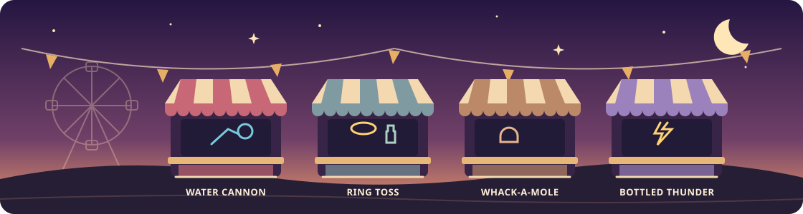

# Carnival Arcade

**A little workshop project, one booth at a time.**



I participated in Tessl's **Build your own software factory with context**
workshop at **AI Native DevCon NYC**. I started with a carnival starter project
and used coding agents and an issue-to-PR workflow to turn small ideas into
playable games.

This is what I shipped from that experiment: a tiny arcade you can explore on
your own computer, with a sunset midway and a few booths to stop at.

## The little things I shipped

| Booth                                                         | The idea                                                                                                                        |
| ------------------------------------------------------------- | ------------------------------------------------------------------------------------------------------------------------------- |
| 🎯 **[Ring Toss](src/games/ring-toss/README.md)**             | Eight rings, a gently swaying aim, and bottles worth more the farther back they stand.                                          |
| 🔨 **[Whack-a-Mole](src/games/whack-a-mole/README.md)**       | A 30-second dash around nine holes. The moles get faster; every hit earns 10 points.                                            |
| ⚡ **[Bottled Thunder](src/games/bottled-thunder/README.md)** | A storm in a glass cabinet. Pull living sparks with a magnetic lantern, release them into matching bottles, and build a streak. |

The **[Water Cannon](src/games/water-cannon/README.md)** came with the starter:
15 shots at moving targets. It was my first game to play and the pattern for
the new booths.

I also added the **orange-to-purple sunset**, made this a standalone project,
and worked through review feedback on timing, touch controls, and scoring.
Each booth has its own logic tests; best scores stay in the browser.

## Try it on your computer

With **Node.js 24** installed:

```sh
git clone https://github.com/xinyuliew/tessl-carnival.git
cd tessl-carnival
npm ci
npm run dev
```

Open the local URL printed in the terminal, usually **http://localhost:5173**.
Keep the terminal running while you play.

**Walk:** WASD, arrow keys, or click a path. **Play:** walk up to a booth and
press **E**, or use the booth list. **Return:** select **Back to the midway**.

This is a local browser app. Your scores belong to that browser and site
address; hosting and an account are not needed to play.

<details>
<summary><strong>A peek behind the booths</strong></summary>

TypeScript · Vite · HTML Canvas · Vitest. No UI framework.

Each game lives in `src/games/<game-id>/`; the midway discovers it automatically.
The shared theme, scores, and registry live in `src/carnival/`.

- `npm run check` — lint, formatting, types, and game-logic tests.
- `npm run build` — make a production build; `npm run preview` serves it locally.
- [Add a booth](skills/add-carnival-game/SKILL.md) · [Contribute](CONTRIBUTING.md) · [Agent guide](AGENTS.md)

</details>

---

A small project by **[xinyuliew](https://github.com/xinyuliew)**.
Started from **[Tessl Carnival](https://github.com/tesslio/tessl-carnival)**
during the workshop. Built with coding agents, then tested and refined through
pull requests. **[MIT licensed](LICENSE)**; original attribution is retained.
